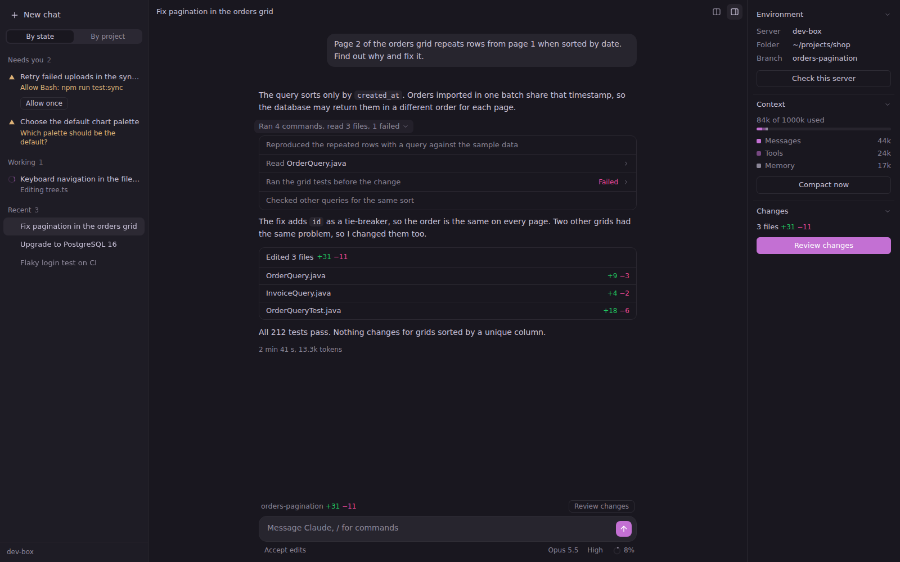
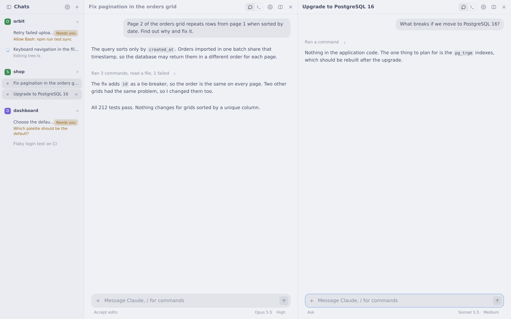

# claude-chat

A chat app for Claude Code in [Muxy](https://github.com/muxy-app/muxy) 2.x. One Muxy tab holds all of it, for every
server: a chats sidebar, chats and terminals side by side and a details rail. Each chat runs its own headless `claude -p`
through a small daemon on the project's server (the Mac or a remote Linux box), so your CLI setup, hooks and permissions
stay as they are; at any time a conversation can continue as the real TUI in a terminal pane and come back.

<p>
  
</p>
<p>
  
</p>

## Features

- **One tab**: sidebar, chats and rail on one page, for every server. Up to three panes side by side: chats, terminals,
  Review, file, plan, tasks, pins and subagent transcripts (`Cmd+D` splits, `Cmd+W` closes).
- **Sidebar**: server → project → chat and terminal, with "Needs you" and working states, drag and drop, and answers to
  permission requests right on the row. `Cmd+E` goes back to the last used chat, `Cmd+Shift+1…9` to chat N.
- **Transcript**: streaming answers, Markdown with tables and highlighted code, images, compaction dividers, older
  history on scroll. Tool work folds into one summary line, then intent rows, then detail in place. View modes Normal,
  Thinking and Verbose. Light and dark follow the Muxy theme.
- **Composer**: queue while Claude works, `/` command and skill completion, `@` files, prompt history, pasted or dropped
  images and files, interrupt, permission mode, model, effort, context ring and 5-hour usage bar.
- **Questions in the flow**: permission cards with the edit's diff, plan approval and Claude's multiple-choice questions,
  fully keyboard-driven, answered over Claude Code's control protocol.
- **Slash commands** with native cards: `/resume`, `/model`, `/effort`, `/usage`, `/status`, `/mcp`, `/agents`, `/hooks`,
  `/permissions`, `/memory`, `/rewind`, `/btw` and more.
- **Chat ⇄ terminal**: continue a conversation as the real TUI (`claude --resume`) in a terminal pane beside the chat,
  which mirrors it, and take it back (`Ctrl+backtick`). Terminals live in the page too (`Cmd+T`, xterm.js), on every
  server with Python. A Claude already running in a terminal can be adopted (`Ctrl+Opt+C`).
- **Review**: uncommitted diff, one turn's edits, a commit or a range; viewed marks, line comments sent to Claude as one
  message, side by side mode and word highlights.
- **Rail**: environment, tasks, context by category, changes, agents.
- **Notifications**: sounds when a chat needs you or has finished, optional banners.
- **Works anywhere**: a server needs a POSIX shell, Python 3.9+ and Claude Code. Without Claude Code, a server shows its
  projects and terminals in the same app. Nothing else to install.
- **Muxy as just the window** (optional, `host/install.sh`): Muxy's own shortcuts move off the keys the app uses, and its
  tab strip, sidebar, bars and pane headers go away. With Muxy 2.4+ this works while Muxy runs.

## Install

Either from the Muxy marketplace, or from this repository:

```bash
git clone https://github.com/ezo5/muxy-claude-chat.git ~/src/claude-chat
python3 ~/src/claude-chat/extension/build.py --no-sample
```

Then in Muxy: **Settings → Extensions → Load Unpacked…**, choose `~/src/claude-chat/extension`, and enable **claude-chat**.

Open it with the top bar icon or **New Chat** (`Cmd+Shift+T`), and allow and remember the prompts on first use. The app
installs its small server package itself, on each server, when it first opens there. Nothing has to be copied or run there.

Optional extras (Muxy as just the window, opening files on the Mac from a remote server, the statusline wrapper) are in
`host/install.sh`; see
[docs/INSTALL.md](docs/INSTALL.md), which also covers requirements, shortcuts, updating from 2.x and uninstalling.

## Docs

- [docs/INSTALL.md](docs/INSTALL.md): installation, options and troubleshooting.
- [CHANGELOG.md](CHANGELOG.md).

## License

MIT, see [LICENSE](LICENSE).
