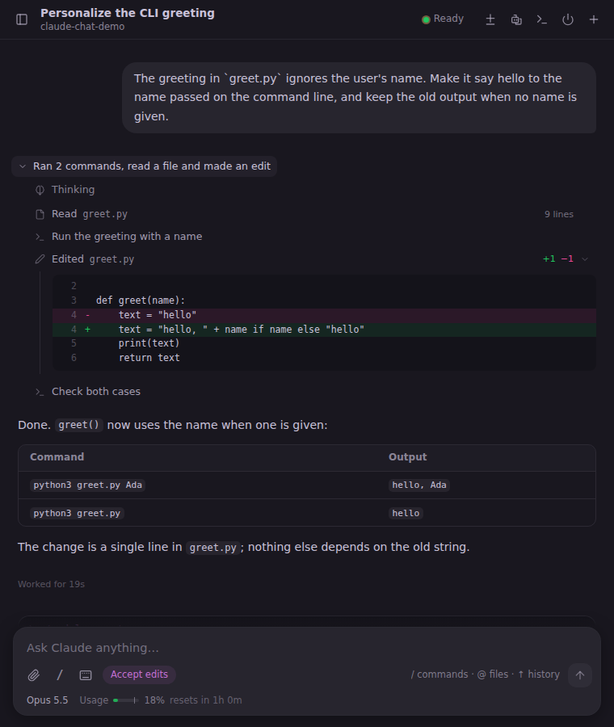
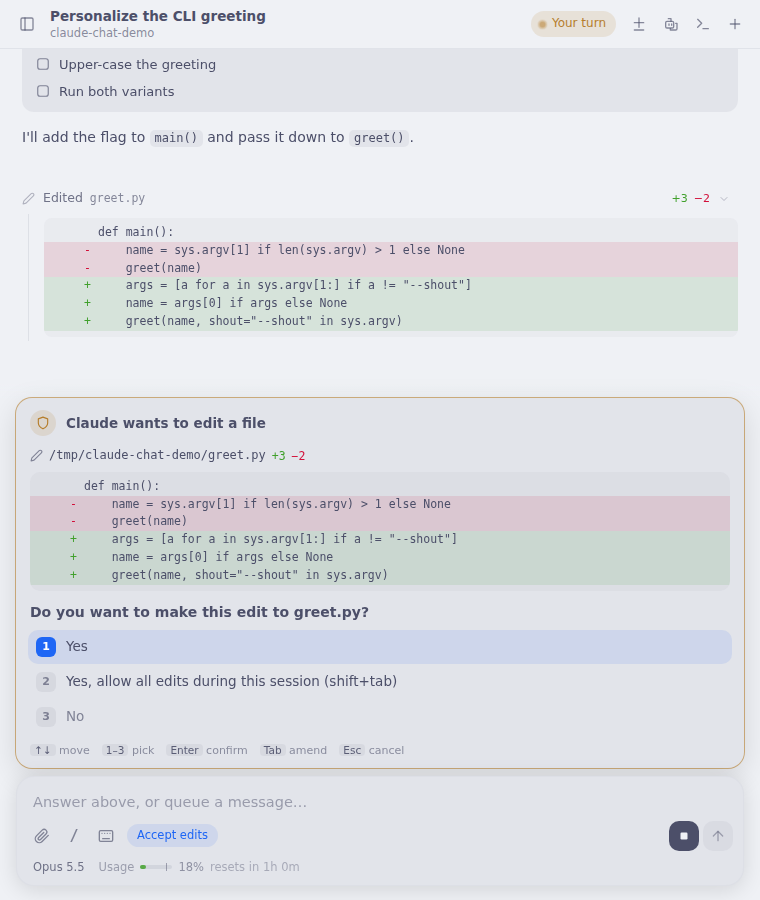
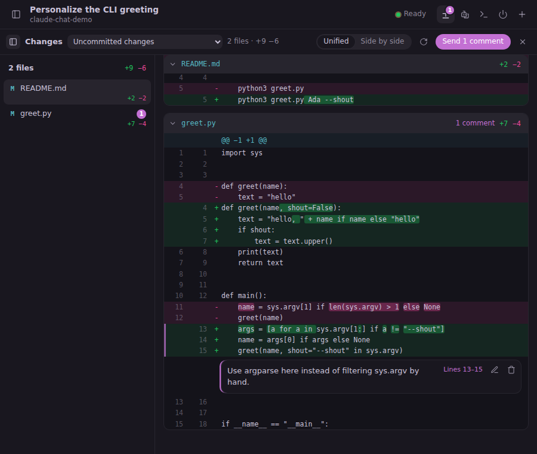

# claude-chat

A chat UI for Claude Code in [Muxy](https://github.com/muxy-app/muxy) 2.x. Each chat tab runs its own headless
`claude -p` through a small daemon on the project server (the Mac or a remote Linux box), so your CLI setup, hooks
and permissions stay as they are; at any time the conversation can continue in a real terminal tab and come back.

<p>
  
  
</p>
<p>
  
</p>

## Features

- **Chat from scratch or from a terminal**: New Chat (`Cmd+Shift+N`) starts a managed `claude -p` for the active
  project; `Ctrl+Opt+C` on a terminal running `claude` mirrors that terminal. Chats reconnect after a restart.
- **Transcript**: streaming answers, Markdown with tables and highlighted code, image thumbnails, compaction
  dividers, and earlier history loaded on scroll. Light and dark theme follow Muxy.
- **Tool cards**: Bash output, Edit/Write diffs with line numbers, Read/Grep/Glob, TodoWrite checklists, subagents,
  web tools, AskUserQuestion, plans, skills and MCP calls. A finished turn folds into "N steps · M edits".
- **Composer**:
  - message queue while Claude works;
  - `/` command and skill completion, `@` file completion, prompt history;
  - pasted or dropped images and files;
  - interrupt (Stop or Esc) and a permission-mode chip.
- **Prompts in the chat**: permission prompts (with the edit's diff and "Yes, and …" suggestions), plan approval and
  Claude's multiple-choice questions show as a card above the composer. Fully keyboard-driven (arrows, 1–9, Space,
  Enter, Tab, Esc, typing for "Other" or a note), answered over Claude Code's control protocol.
- **Slash commands**: `/resume` opens a searchable picker of earlier conversations, `/model` and `/effort` switch
  from a picker, `/clear` shows a divider, and command output shows in one card.
- **Chat ⇄ terminal**: Ctrl+backtick continues the conversation in a terminal tab (`claude --resume`) and the chat
  mirrors it; "Back to chat" ends the terminal Claude and the chat takes over. A Claude already running in a
  terminal can be adopted the same way (`Ctrl+Opt+C`).
- **Review**: the uncommitted diff, Claude's edits in one turn, a commit or a commit range; comment lines or line
  ranges and send all comments to Claude as one message. Side by side mode and word-level highlights.
- **Agents sidebar**: subagents (also nested ones and those of old transcripts) and background commands with live
  status; a click opens a subagent's transcript in its own tab.
- **Usage strip**: context, 5-hour and weekly limits and cost under the composer, from the session itself; an
  optional statusline wrapper (`--statusline`) adds a 24 h sparkline and keeps your own statusline.
- **Open files** in Zed, IntelliJ or Finder on the Mac, also from a remote server that shares a folder with the Mac.

## Install

Quit Muxy, then run this on the Mac:

```bash
git clone https://github.com/ezo5/muxy-claude-chat.git ~/src/claude-chat
~/src/claude-chat/host/install.sh --local --statusline            # Claude runs on this Mac
~/src/claude-chat/host/install.sh --server devbox --statusline    # Claude runs on a Muxy remote server
```

`devbox` is the `ssh` value of a Muxy `[[servers]]` entry: any Linux box or VM (Lima, UTM, OrbStack, …) that Muxy
reaches over SSH.

Start Muxy and open a chat: palette → **Claude Chat: New Chat** (`Cmd+Shift+N`), or focus a terminal running
`claude` and press `Ctrl+Opt+C`. Allow and remember the permission prompts on first use.

Requirements, remote servers, the open-file bridge, updating and uninstalling are covered in
[docs/INSTALL.md](docs/INSTALL.md).

## Docs

- [docs/INSTALL.md](docs/INSTALL.md): installation, options and troubleshooting.
- [CHANGELOG.md](CHANGELOG.md).

## License

MIT, see [LICENSE](LICENSE).
